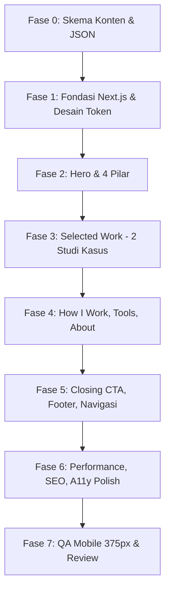

# AGENTS.md — AI Coding Agent Operating Guide

> **Status:** Active & Mandatory  
> **Target Proyek:** Portfolio Nazar Gunawan — Tech-Savvy Virtual Assistant  
> **Dokumen Sumber Kebenaran (Single Source of Truth):** [PRD.md](file:///d:/KERJAAN/CODING/COMBO/portfolio-va/PRD.md) & [design.md](file:///d:/KERJAAN/CODING/COMBO/portfolio-va/design.md)

Panduan ini mengatur perilaku, batasan arsitektur, konvensi kode, serta standar kualitas untuk setiap AI Coding Agent (Antigravity, Claude Code, Cursor, Copilot, dll.) yang bekerja di repository ini. **Semua aturan di bawah ini bersifat mengikat dan non-negotiable.**

---

## 1. Identitas & Positioning Proyek

1. **Bukan Portfolio Developer Kedua:**
   - Portfolio software engineer Nazar sudah aktif di `nazargunawan.vercel.app`.
   - Repository ini **khusus** memposisikan Nazar sebagai **Tech-Savvy Virtual Assistant** (Pilar: *Research, Operations, Data, Automation*).
   - Nilai jual unik (USP): *"A remote assistant who doesn't just manage your tasks — he builds the systems that make your work easier."*
   - Proyek development (Next.js, Flutter, backend) hanya boleh disebut ringkas sebagai bukti pondasi teknis (*technical capability*), bukan menu utama.
2. **Karakter & Tone Desain:**
   - **Editorial Newspaper × Soft Neo-Brutalism × 90s Details** (Proporsi: 60% Editorial / 25% Neo-Brutalism / 15% Detail 90s).
   - Kesan yang wajib tercapai: *Organized, research-minded, calm, reliable, trustworthy with data*.
   - Target audiens: Founder solo, small business owner, tim remote global (2–15 orang) yang bersedia membayar di atas rate VA administratif standar.

---

## 2. Aturan Mutlak Anti-AI Slop (Strict Negatives)

AI agents cenderung menghasilkan pola generik ("AI slop") jika tidak dibatasi secara ketat. **DILARANG KERAS menghasilkan hal-hal berikut:**

| DILARANG (AI Slop) | ATURAN YANG BENAR |
|---|---|
| Gradien ungu/biru/pink ala generic SaaS template | Background paper `#F4F0E8`, ink `#171717`, satu aksen terracotta `#D94F35`. |
| Kartu serba membulat (`rounded-xl`, `rounded-2xl`, `rounded-full`) | `rounded-[2px]` maksimal. Sudut tegas editorial, bukan pil gelembung. |
| Shadow abu-abu kabur/blurry (`shadow-lg`, `shadow-2xl`) | Hard shadow hitam tegas ala neo-brutalisme pada tombol/kartu utama (`box-shadow: 3px 3px 0px #171717`). |
| Glassmorphism / backdrop-blur berlebihan | Solid opaque paper panels. Tidak ada transparansi frosted glass generik. |
| Animasi fade-slide-up di setiap section saat scroll | **Satu-satunya** orchestrated sequence hanya di Hero (≤600ms). Section lain muncul langsung tanpa scroll-jacking. |
| Eyebrow label ALL-CAPS di atas setiap heading | Larang dekorasi teks tanpa fungsi informasi. Gunakan heading editorial yang kuat. |
| Nomor urut (01, 02) ditempel ke semua section | Nomor urut **HANYA** untuk `How I Work` (karena proses berurutan). Pilar & Tools dilarang memakai nomor urut. |
| Hardcode copy teks panjang di dalam komponen JSX | Semua copy wajib diambil dari `/content/*.json` melalui helper bertipe. |
| Membocorkan istilah internal Sheets PRD | Jangan pernah memunculkan nama sheet internal (`_DB_STOK`), nama fungsi Apps Script, dsb. Tulis dari sudut pandang *business outcome*. |
| Menambahkan warna aksen kedua "biar variatif" | **Hanya 1 warna aksen**: `#D94F35`. Variasi visual berasal dari tipografi, border line, dan whitespace. |

---

## 3. Tech Stack & Aturan Arsitektur

- **Framework:** Next.js (App Router, SSG/Static Export ready)
- **Bahasa:** TypeScript (Strict mode, no `any`)
- **Styling:** Tailwind CSS (dengan custom design tokens di `tailwind.config.ts`)
- **Fonts:** `next/font/google` (Fraunces, IBM Plex Sans, IBM Plex Mono)
- **State & Rendering:**
  - **Server Components secara default.** Jangan gunakan `'use client'` kecuali ada kebutuhan browser murni (misal: toggle nav mobile, deteksi scroll sticky nav).
  - Tidak ada state library berat (Redux/Zustand tidak dibutuhkan di V1).
- **Decoupled Content Architecture:**
  - Komponen UI bersifat murni presentasional.
  - Data teks, studi kasus, metadata, dan daftar pilar disimpan dalam file JSON di `/content/`.
  - Helper loader tersentralisasi di `lib/content.ts` dengan interface TypeScript di `lib/types.ts`.

---

## 4. Design System & Design Tokens Enforcement

Semua style wajib mematuhi spesifikasi di [design.md](file:///d:/KERJAAN/CODING/COMBO/portfolio-va/design.md):

### 4.1 Token Warna

```css
/* Token CSS dasar */
--color-paper: #F4F0E8;        /* Background utama website */
--color-paper-raised: #EAE4D6; /* Background kartu / section alternatif */
--color-ink: #171717;          /* Teks utama, garis batas tebal */
--color-ink-soft: #4A4640;     /* Teks body panjang / sekunder */
--color-accent: #D94F35;       /* Satu warna aksen: CTA, highlight, active state */
--color-accent-ink: #FFFFFF;   /* Teks di atas warna aksen */
--color-line: #171717;         /* 100% untuk border tebal, 15% opacity untuk hairline */
--color-focus: #2F6FED;        /* Ring fokus aksesibilitas (biru, bukan aksen) */
```

### 4.2 Tipografi & Hierarki

| Peran | Font Family | Variabel CSS | Pemakaian |
|---|---|---|---|
| **Display / Headings** | Fraunces (Optical serif) | `var(--font-display)` | Headline hero (44px → 88px), Judul section H1 (32px → 48px), Judul studi kasus H2 (22px → 28px) |
| **Body & UI** | IBM Plex Sans | `var(--font-body)` | Paragraf umum (15px/16px), intro body-lg (18px/20px), label tombol |
| **Terminal / Meta / Status** | IBM Plex Mono | `var(--font-mono)` | Khusus status badge (`● AVAILABLE`), tag kapabilitas, meta data |

**Aturan Tipografi:**
- Lebar baris teks (line-length) dibatasi maksimal `max-w-[65ch]` (jangan biarkan paragraf melebar penuh selebar layar).
- Alignment default: **Left-aligned** (gaya koran editorial), bukan centered.
- Headline hero berukuran dramatis/oversized tapi tetap left-aligned.

### 4.3 Borders, Radius, & Shadows
- **Border:** Solid `1px` atau `1.5px` warna `#171717` untuk kartu, `border-b border-ink/15` untuk hairline divider.
- **Border Radius:** `rounded-[2px]` konsisten.
- **Button CTA:** Hard shadow `shadow-[3px_3px_0px_#171717]`. Pada state `:active`, transform translate `translate-x-[2px] translate-y-[2px]` dengan reduksi shadow menjadi `1px 1px 0px`.

### 4.4 Motion & Reduced Motion
- **Satu-satunya animasi masuk:** Hero entrance sequence saat halaman dimuat (Status badge → Headline → Sub-copy → CTA), total durasi ≤ 600ms (`ease-out`).
- **Section lain:** Muncul secara statis/instan tanpa scroll animation.
- **Reduced motion:** Seluruh animasi dan transisi wajib dibungkus `@media (prefers-reduced-motion: reduce)` dengan durasi 0s / instan.

---

## 5. Struktur Direktori Proyek

Struktur folder yang wajib diikuti persis:

```text
portfolio-va/
├── AGENTS.md                 # Dokumen aturan ini
├── PRD.md                    # Product Requirements Document
├── design.md                 # Design System & Tech Specs
├── app/
│   ├── layout.tsx            # Root layout, inject font variables, base metadata
│   ├── page.tsx              # Landing page V1 (merangkai seluruh section P0)
│   ├── globals.css           # CSS variables, base styles, typography reset
│   ├── sitemap.ts            # Dynamic SEO sitemap
│   └── robots.ts             # Robots configuration
├── components/
│   ├── layout/
│   │   ├── SiteNav.tsx       # Sticky minimal nav, anchor links, CTA
│   │   └── SiteFooter.tsx    # Footer editorial, links, timezone
│   ├── sections/
│   │   ├── Hero.tsx          # Section 8.1 PRD
│   │   ├── Pillars.tsx       # "What I Can Take Off Your Plate" (8.2 PRD)
│   │   ├── SelectedWork.tsx  # "Things I've Built & Organized" (8.3 PRD)
│   │   ├── WorkCard.tsx      # Reusable card component
│   │   ├── HowIWork.tsx      # Timeline 4 langkah (8.4 PRD)
│   │   ├── Tools.tsx         # Kategori tools (8.5 PRD)
│   │   ├── About.tsx         # Bio ringkas & credentials (8.6 PRD)
│   │   └── ClosingCta.tsx    # Final conversion section (8.7 PRD)
│   └── ui/
│       ├── Button.tsx        # Neo-brutalist button (primary hard-shadow, ghost)
│       ├── StatusBadge.tsx   # Badge "● Available" gaya 90s terminal
│       ├── TagList.tsx       # Tag kapabilitas (IBM Plex Mono)
│       └── SectionHeading.tsx# Reusable editorial heading component
├── content/
│   ├── hero.json
│   ├── pillars.json
│   ├── how-i-work.json
│   ├── tools.json
│   ├── about.json
│   ├── contact.json
│   └── work/
│       ├── umkm-toolkit.json
│       └── student-os.json
├── lib/
│   ├── content.ts            # Typed loaders untuk file JSON di /content
│   └── types.ts              # TypeScript interfaces untuk content schema
├── public/
│   ├── og/
│   │   └── og-image.png      # Custom OpenGraph banner
│   └── favicon.ico
├── tailwind.config.ts        # Mapping token warna, font, radius, max-w
├── tsconfig.json
└── package.json
```

---

## 6. Model Konten & Copywriting Guardrails

### 6.1 Bahasa & Audiens
- Seluruh teks antarmuka (copy utama) wajib menggunakan **bahasa Inggris** yang natural, ringkas, dan percaya diri (target audiens global/remote).
- Elemen kecil lokal hanya diizinkan untuk metadata geografis (mis. `Indonesia · GMT+7`).

### 6.2 Studi Kasus Inti (Selected Work)
Hanya ada 2 studi kasus utama di V1:
1. **UMKM Business Toolkit** (Google Sheets + Apps Script):
   - Framing: Sistem POS, inventaris, dan kalkulasi HPP otomatis untuk pemilik toko kecil tanpa perlu aplikasi baru.
   - Poin nilai: Idempoten, tahan salah input, siap 10.000+ data, dashboard laba-rugi otomatis.
   - Tag: `Data Modeling`, `Google Apps Script`, `Business Logic`, `UX for Non-Technical Users`.
2. **Student OS** (Google Sheets + Apps Script + Drive):
   - Framing: Personal operating system perkuliahan (jadwal, tugas, kalkulator GPA, integrasi folder Drive otomatis).
   - Poin nilai: Struktur folder otomatis, indexing lampiran file terintegrasi, arsitektur data 4 tahun.
   - Tag: `System Design`, `Google Drive Automation`, `Information Architecture`, `Product Thinking`.
3. **Technical Capability (Supporting Note):**
   - Satu baris catatan editorial di bawah studi kasus: Merujuk ke portfolio developer (`nazargunawan.vercel.app`) bagi calon klien yang ingin verifikasi kapabilitas engineering mendalam.

---

## 7. Protokol Eksekusi AI Agent (Phased Execution)

**JANGAN PERNAH membangun seluruh aplikasi dalam satu giliran instruksi.** Ikuti tahapan berurutan sesuai PRD §13.2:



### Definition of Done (DoD) Tiap Section:
1. **Responsif Mobile:** Wajib diuji dan lulus tampilan di viewport lebar **375px** tanpa horizontal scroll.
2. **Decoupled:** Teks tidak boleh di-hardcode di file `.tsx`.
3. **Aksesibilitas:** Kontras warna memenuhi WCAG AA, elemen interaktif memiliki `focus-visible:ring-2 focus-visible:ring-focus`.
4. **Semantik:** Menggunakan elemen HTML5 semantik (`<header>`, `<main>`, `<section>`, `<article>`, `<footer>`).
5. **No Broken Links:** Anchor navigation (`#work`, `#how-i-work`, `#about`, `#contact`) berfungsi mulus dengan `scroll-smooth`.

---

## 8. Checklist Verifikasi Mandiri (Self-Audit Gate)

Sebelum AI agent menyatakan suatu tugas selesai, jalankan checklist ini:

- [ ] **Tidak ada AI Slop:** Tidak ada rounded-2xl, tidak ada gradient ungu, tidak ada card shadow kabur, tidak ada scroll animation berulang.
- [ ] **Satu Aksen:** Warna `#D94F35` adalah satu-satunya warna aksen yang digunakan.
- [ ] **Tipografi Benar:** Headline memakai Fraunces, body memakai IBM Plex Sans, meta/status memakai IBM Plex Mono.
- [ ] **Mobile-First:** Tampilan 375px terverifikasi rapi dan padding tidak overflow.
- [ ] **Kerahasiaan Teknis PRD:** Tidak ada variabel atau nama sheet rahasia/internal (`_DB_STOK`, dsb.) yang tampil di copy publik.
- [ ] **TypeScript Bersih:** Tidak ada error tipe, tidak ada pemakaian `any`.
- [ ] **Performa:** Skrip eksternal tidak memblokir render, skor Lighthouse mobile berorientasi ≥ 90.
